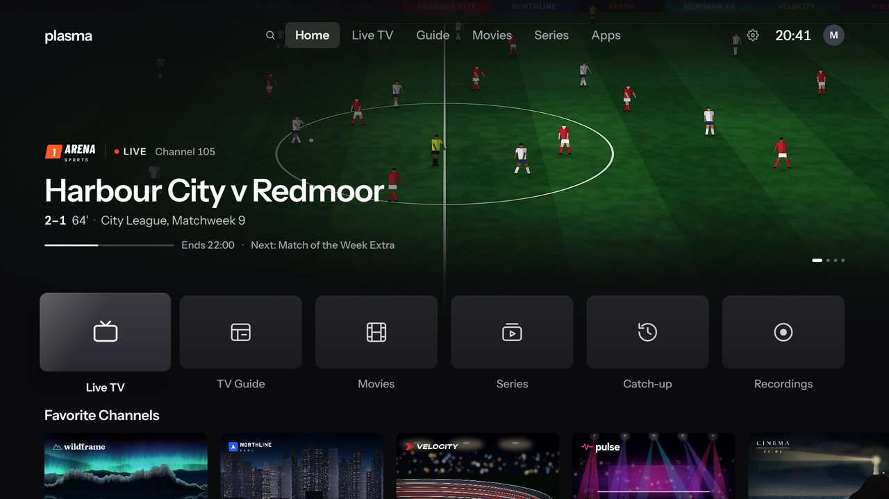
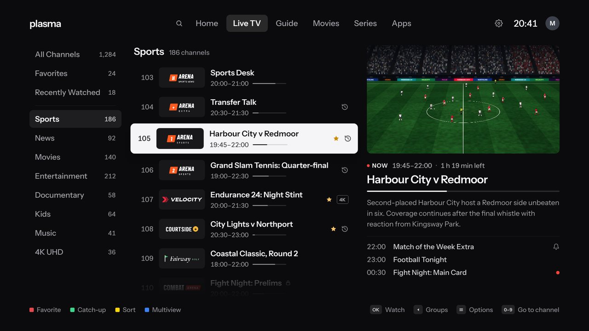
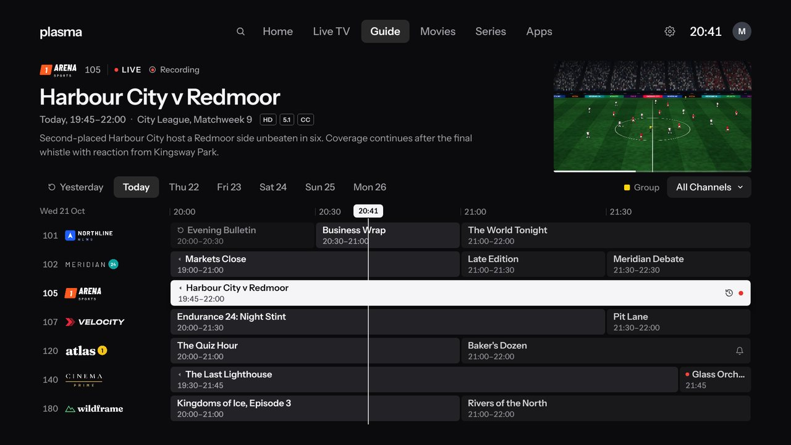
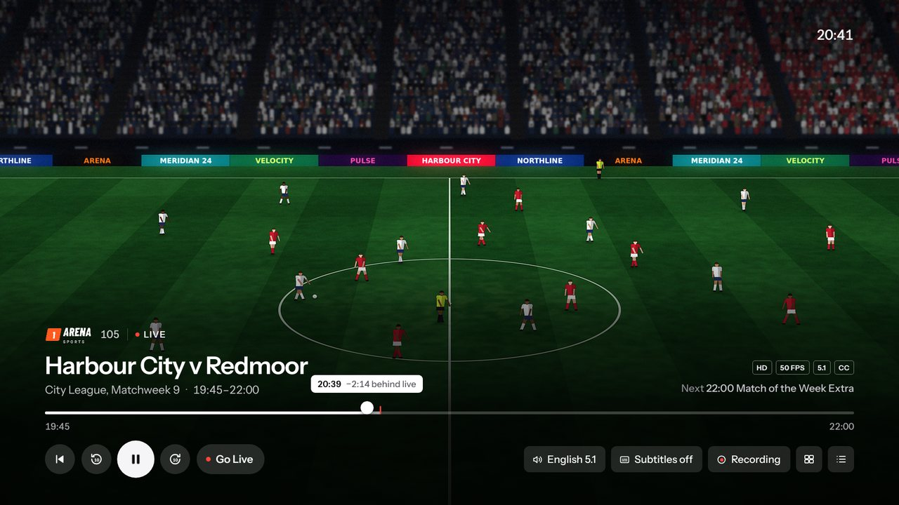
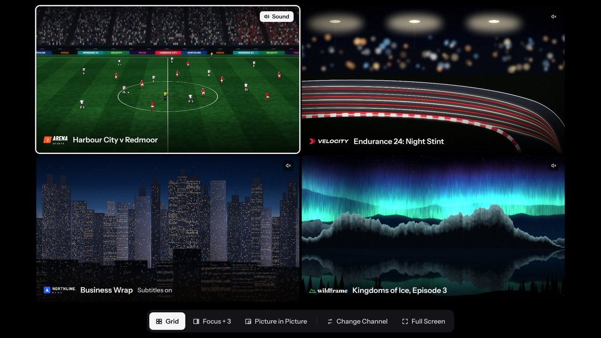
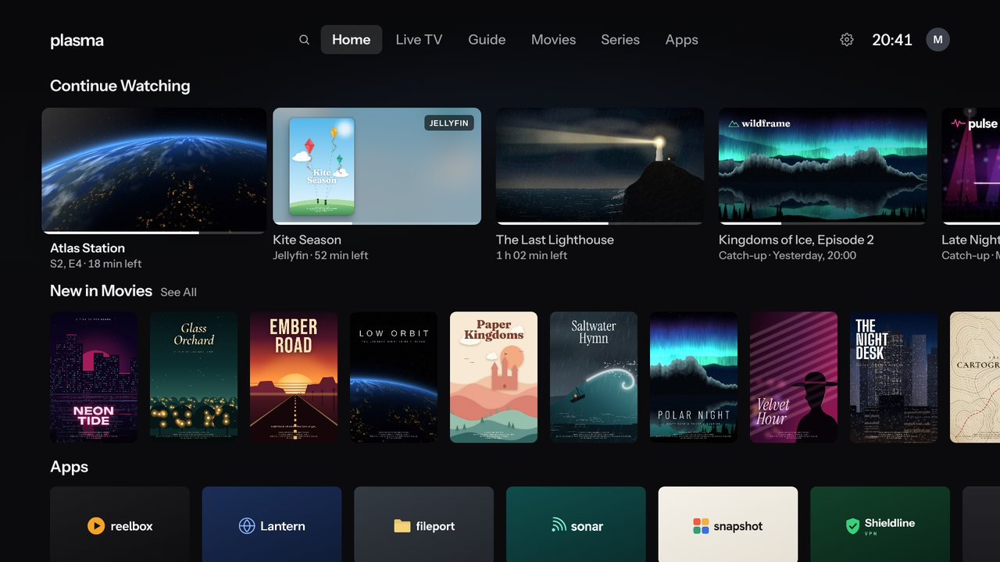
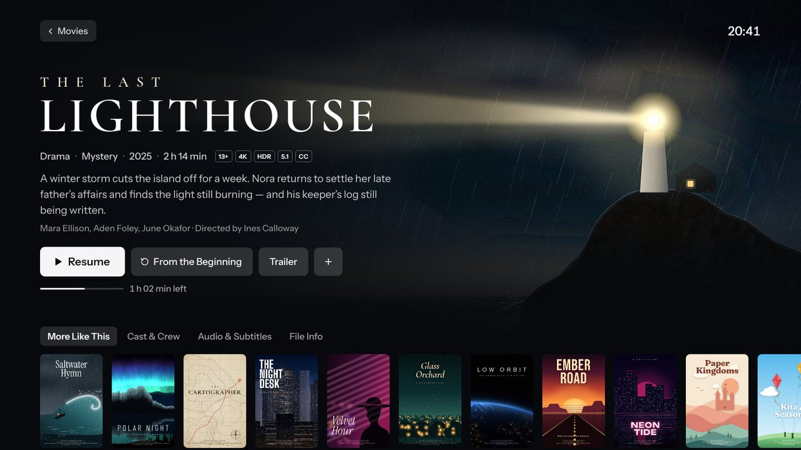

<p align="center">
  <picture>
    <source media="(prefers-color-scheme: dark)" srcset="docs/images/plasma-logo-horizontal-white.svg">
    
  </picture>
</p>

<p align="center">
  <b>An IPTV player for Android TV that is also the TV's home screen.</b><br>
  Press Home and your last channel keeps playing behind your favorites, the guide, movies, series, recordings and your apps.
</p>

<p align="center">
  <a href="https://github.com/gureetk/plasma/actions/workflows/build.yml"></a>
  <a href="LICENSE"></a>
  
  
  <a href="https://github.com/gureetk/plasma/releases"></a>
</p>

<p align="center">
  
</p>

> [!IMPORTANT]
> **Plasma comes with no channels, playlists or subscriptions.** It plays a service you already have: an Xtream Codes login, a Stalker (MAG) portal, or an M3U playlist with an XMLTV guide. Issues and pull requests that add, ask for or link to streams, playlists or providers will be closed.

## Features

**Live TV**
- A channel list with a live preview, channel numbers you can type, and favorites in your own order
- The TV Guide by day, with reminders, and search across your guide, movies and series
- Catch-up and Start Over from your provider's archive, pausing and rewinding any channel, and local catch-up for channels without an archive
- Multiview: up to four channels at once, as many as your TV can decode
- One channel from several sources, which fails over to the next source when one drops

**Movies and series**
- Your provider's catalog by category, with each title's page, My List and Mark as Watched
- Carry on where you stopped, with the next episode up next and Continue Watching on Home
- Dolby Vision and HDR10+ movies through Android's own player

**Recordings**
- Record a program or a whole series, on time even with the TV off
- Save them on the TV, a USB drive or a network folder, named so Jellyfin picks them up with their details and artwork

**Your TV's home screen**
- The Home button opens Plasma, through an Accessibility override or by replacing Google TV Home, which Plasma does from the TV itself and can undo
- Your apps and inputs, a screensaver, and picture-in-picture when you open another app, on TVs that have it
- Continue Watching from other apps and from your Jellyfin server

**Playback**
- libVLC first, with mpv and Android's own player as fallbacks, switching on the same connection when a stream won't play
- Frame-rate matching, sound passed through to your receiver, a volume level per channel, and sound and subtitle tracks chosen by your language
- Picture Size, a sleep timer, and the stream's details in Player Options

**For everyone at home**
- Up to six profiles, each with its own favorites, history and resume points, including kids and guest profiles
- Parental controls with a PIN: locked channels and groups, adult groups, and an age limit from your guide's ratings
- Your phone as a remote and keyboard: the TV serves the page, so there's nothing to install. You can add a source from your phone too.

No ads, no analytics, and no account to create.

## Screenshots

<table>
  <tr>
    <td width="50%"><p align="center">Live TV</p></td>
    <td width="50%"><p align="center">TV Guide</p></td>
  </tr>
  <tr>
    <td><p align="center">Player</p></td>
    <td><p align="center">Multiview</p></td>
  </tr>
  <tr>
    <td><p align="center">Continue Watching</p></td>
    <td><p align="center">Movies</p></td>
  </tr>
</table>

The screens come from the app's own screenshot tests, on its made-up sample channels and titles.

## Download

Plasma isn't on Google Play, and there's no stable release yet. Test builds of **Plasma Dev** are on the [Releases page](https://github.com/gureetk/plasma/releases), each with three APKs:

- **Many TVs and streamers**, including the Chromecast with Google TV, which run 32-bit Android even on a 64-bit chip: `app-armeabi-v7a-dev.apk`
- **64-bit Android TV**, such as the Android TV emulator on an Apple-silicon Mac: `app-arm64-v8a-dev.apk`
- **Not sure?** `app-universal-dev.apk` works on both, and is bigger.

To install one from a computer on the same network:

1. On the TV, turn on Developer options and Network debugging (or Wireless debugging).
2. Then:

   ```sh
   adb connect <tv-ip>:5555
   adb install -r app-armeabi-v7a-dev.apk
   ```

Plasma Dev (`ca.gureet.plasma.dev`) and Plasma (`ca.gureet.plasma`) are signed with different keys and install side by side. Once installed, Plasma updates itself from **Settings › About › Plasma Update**, after asking.

## Getting started

1. Open Plasma. Until you add a source it shows made-up sample channels, so you can look around.
2. Add your service in **Settings › Portals & Playlists › Add Portal or Playlist**: an Xtream Codes login, a Stalker portal (Plasma makes a MAC address for the TV, or you can type the one your provider registered), or an M3U playlist with its XMLTV guide. It's quickest from your phone: scan the code on that screen and type there.
3. Make Plasma your home screen in **Settings › Launcher & Home › Home Screen**.
4. To use your phone as a remote, open **Settings › Remote & Buttons › Phone Remote**.

## Status

Plasma is young and moving fast. The milestones come from the [design brief](docs/DESIGN.md):

| | Milestone | Status |
|---|---|---|
| M0 | Foundations: the design system, and every screen on sample data | Done |
| M1 | Live TV on VLC, with its guide | Done |
| M2 | The Guide by day, catch-up and Start Over, reminders and search | Done |
| M3 | Stalker portals, several sources with failover, mpv, channel numbers | Done |
| M4 | Movies and series, resume and Continue Watching, Dolby Vision | Done |
| M5 | The launcher: the Home button, apps and inputs, the screensaver, updates | Done |
| M6 | Recording, the rewind buffer and local catch-up | Done |
| M7 | Profiles, parental controls, Multiview and the phone remote | Done |
| M8 | Hardening and the first release | Next |
| M9 | Plasma Remote apps for Android and iPhone | Planned |

What to check on a TV is in [docs/testing.md](docs/testing.md).

## Building from source

You need JDK 21 and the Android SDK (platform 37).

```sh
./gradlew :app:assembleDebug                              # debug build: ca.gureet.plasma.debug
./gradlew :app:assembleDev                                # test build:  ca.gureet.plasma.dev ("Plasma Dev")
./gradlew testDebugUnitTest -Proborazzi.test.verify=true  # unit tests, and screens compared with their reference images
./gradlew recordRoborazziDebug                            # update the reference images after a deliberate UI change
```

Every screen has a reference image at 1920 × 1080 in its module's `src/test/screenshots`, named after its design board (`feature/home/src/test/screenshots/01-home.png`). CI fails a pull request whose screens no longer match them. `tools/gen_readme_images.py` makes this README's screenshots from them.

<details>
<summary>How the code is laid out</summary>

<br>

The modules follow section 6.2 of the brief.

| Module | What it holds |
|---|---|
| `app` | The TV app: navigation, and everything wired together |
| `core/design` | The design system: colors, type, focus and components |
| `core/model`, `core/database`, `core/data`, `core/network` | Settings and models, the Room database, the repositories, and HTTP with redacted logs |
| `core/fixtures`, `core/testing` | The made-up sample world the screens run on, and the screenshot tests' base |
| `source/xtream`, `source/stalker`, `source/m3u`, `epg` | A client for each kind of source, and the XMLTV guide |
| `channels`, `stream` | Merging and numbering channels; the stream hub, which opens live streams for the players and keeps the rewind buffer |
| `player/core`, `player/vlc`, `player/mpv`, `player/media3` | The player and its three engines |
| `feature/*` | The screens |
| `launcher`, `adb`, `update` | The Home button, apps and inputs; Plasma's own ADB client, for replacing Google TV Home; updates |
| `recording` | Recordings, local catch-up and network folders |
| `pairing`, `remote`, `remote-protocol` | The pages the TV serves to phones: adding a source, and the phone remote with its protocol |
| `integrations/jellyfin`, `integrations/watchnext` | Jellyfin, and Android's Play Next row |

</details>

<details>
<summary>Publishing a release</summary>

<br>

Plasma reads `update.json`, which lists each APK with its SHA-256: Plasma Dev from the `dev` pre-release, which CI points at each new build on `main`, and Plasma from the newest release. A release is built and signed on the release machine, and published with its update file:

```sh
./gradlew :app:assembleRelease :app:writeReleaseUpdateFile \
  -Pplasma.updateBase=https://github.com/<owner>/<repo>/releases/download/v0.2.0 \
  -Pplasma.updateNotes="What's new in this version."
gh release create v0.2.0 app/build/outputs/apk/release/*.apk app/build/outputs/update/release/update.json
```

`plasma.updates.release` and `plasma.updates.dev` point a build at an update file somewhere else.

</details>

## Documentation

- [docs/DESIGN.md](docs/DESIGN.md): the design and build brief
- [docs/decisions.md](docs/decisions.md): what's been decided since the brief
- [docs/testing.md](docs/testing.md): what to check on a TV, milestone by milestone
- [docs/design/screens](docs/design/screens): the approved design boards

## Contributing

Bug reports and ideas are welcome: use the issue forms. Before opening a pull request, read [CONTRIBUTING.md](CONTRIBUTING.md), and follow the [code of conduct](CODE_OF_CONDUCT.md). If you've found a security problem, please report it privately, as [SECURITY.md](SECURITY.md) explains.

## License

Plasma is free software, released under the [GNU General Public License v3.0 or later](LICENSE). The phone remote protocol and the phone apps, when they arrive, will be under the Apache License 2.0, as noted in their folders. The bundled fonts are under the SIL Open Font License 1.1. The SPAKE2 code in `adb/src/main/java` is Flyfish233's spake2-java, under the GNU General Public License v3.0, and the curve libraries it uses are under the MIT License. The sample art in `docs/design` and in the test fixtures is made up and isn't real channel or film branding.

## Acknowledgements

Plasma is built on [libVLC](https://www.videolan.org/vlc/libvlc.html), [mpv](https://mpv.io) (through Findroid's [libmpv build](https://central.sonatype.com/artifact/dev.jdtech.mpv/libmpv)), [AndroidX Media3](https://developer.android.com/media/media3), the [Jellyfin Kotlin SDK](https://github.com/jellyfin/jellyfin-sdk-kotlin), [smbj](https://github.com/hierynomus/smbj), [OkHttp](https://square.github.io/okhttp/), [Coil](https://coil-kt.github.io/coil/), [ZXing](https://github.com/zxing/zxing), [spake2-java](https://github.com/Flyfish233/spake2-java) and [curve25519-elisabeth](https://github.com/cryptography-cafe/curve25519-elisabeth), and tested with [Robolectric](https://robolectric.org) and [Roborazzi](https://github.com/takahirom/roborazzi). Its type is set in Instrument Sans, Cormorant Garamond, Unbounded and Space Mono.
