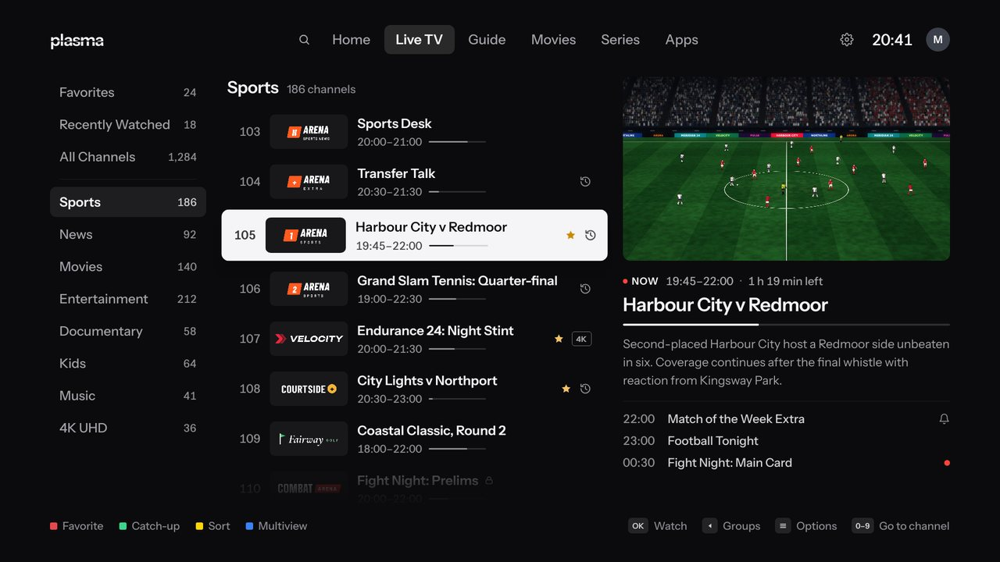

The first release of Plasma: an IPTV player for Android TV that is also the TV's home screen.

Plasma turns an Android TV or Google TV device into a set-top box. Live channels, the TV Guide, movies, series and recordings are in one place, alongside your apps and inputs, and it's all built for the remote: everything works with the D-pad, OK, Back and Home.

Plasma comes with no channels, playlists or subscriptions. It plays a service you already have: an **Xtream Codes** login, a **Stalker (MAG) portal**, or an **M3U playlist** with an XMLTV guide.



*Live TV, on Plasma's made-up sample channels. There are more screens in the [README](https://github.com/gureetk/plasma#screenshots).*

## What's in it

### Live TV
- A channel list with a live preview, channel numbers you can type, and favorites in your own order
- The TV Guide by day, with reminders, and search across your guide, movies and series
- Catch-up and Start Over from your provider's archive, pausing and rewinding any channel, and local catch-up for channels without an archive
- Multiview: up to four channels at once, as many as your TV can decode
- One channel from several sources, which fails over to the next source when one drops

### Movies and series
- Your provider's catalog by category, with each title's page, My List and Mark as Watched
- Carry on where you stopped, with the next episode up next and Continue Watching on Home
- Dolby Vision and HDR10+ movies through Android's own player

### Recordings
- Record a program or a whole series, on time even with the TV off
- Save them on the TV, a USB drive or a network folder, named so Jellyfin picks them up with their details and artwork

### Your TV's home screen
- The Home button opens Plasma, through an Accessibility override or by replacing Google TV Home, which Plasma does from the TV itself and can undo
- Your apps and inputs, a screensaver, and picture-in-picture when you open another app, on TVs that have it
- Continue Watching from other apps and from your Jellyfin server

### Playback
- mpv first, with libVLC and Android's own player as fallbacks, switching on the same connection when a stream won't play
- Frame-rate matching, sound passed through to your receiver, a volume level per channel, and sound and subtitle tracks chosen by your language
- Picture Size, a sleep timer, and the stream's details in Player Options

### For everyone at home
- Up to six profiles, each with its own favorites, history and resume points, including kids and guest profiles
- Parental controls with a PIN: locked channels and groups, adult groups, and an age limit from your guide's ratings
- Your phone as a remote and keyboard: the TV serves the page, so there's nothing to install. You can add a source from your phone too.
- Favorites, categories, hidden channels and locks organized from a computer's or a phone's browser, with Edit in a Browser
- Settings backed up to a file and restored on another TV

No ads, no analytics, and no account to create.

## Which APK

| Your device | APK |
|---|---|
| Most TVs and streamers, including the Chromecast with Google TV, which run 32-bit Android even on a 64-bit chip | `app-armeabi-v7a-release.apk` |
| 64-bit Android TV, such as the Android TV emulator on an Apple-silicon Mac | `app-arm64-v8a-release.apk` |
| Not sure | `app-universal-release.apk`: works on both, and is bigger |

Plasma needs Android 8.0 or later. It also runs as an app on Fire TV devices with Fire OS 7 or later, where Amazon's home screen stays. `SHA256SUMS` lists each APK's SHA-256.

## Installing

Plasma isn't on Google Play. The easiest way to install it is with the free Downloader app, on the TV itself.

**With Downloader, on the TV:**

1. Install **Downloader by AFTVnews** from Google Play on the TV, or from the Amazon Appstore on a Fire TV.
2. Turn on Developer options: open **Settings › System › About** and press OK on **Android TV OS build** seven times.
3. Let Downloader install apps: in **Settings › Apps › Security & restrictions › Unknown sources**, turn on Downloader. Some TVs ask the first time Downloader installs something instead. On a Fire TV, it's **Install unknown apps** in **Settings › My Fire TV › Developer Options**.
4. Open Downloader, type `plasma.gureet.ca/tv` and choose **Go**.
5. Choose your file, then **Install**.

**From a computer on the same network:**

1. On the TV, turn on **Developer options** and **Network debugging** (or **Wireless debugging**).
2. Then:

   ```sh
   adb connect <tv-ip>:5555
   adb install -r app-armeabi-v7a-release.apk
   ```

Installed with Downloader or a file manager on Android 13 or later? Android may gray out the Accessibility switch Plasma uses for the Home button: open Plasma's App info and choose **⋮ › Allow restricted settings**, or use **Turn On over Wireless Debugging** in Plasma's Home Button Override sheet.

## Getting started

1. Open Plasma. Until you add a source it shows made-up sample channels, so you can look around.
2. Add your service in **Settings › Portals & Playlists › Add Portal or Playlist**. It's quickest from your phone: scan the code on that screen and type there.
3. Make Plasma your home screen in **Settings › Launcher & Home › Home Screen**.
4. To use your phone as a remote, open **Settings › Remote & Buttons › Phone Remote**.

From now on, Plasma updates itself from **Settings › About › Plasma Update**, after asking.

## Good to know

- **Plasma Dev**, the test builds on the Releases page, is a separate app: it installs beside Plasma and keeps its own settings. To bring them over, use **Back Up Settings** in Plasma Dev and **Restore from Backup** in Plasma.
- Problems and ideas are welcome as [issues](https://github.com/gureetk/plasma/issues). **Settings › About › Report a Problem** opens one from your phone, with the TV's diagnostics to attach: logins, passwords and server addresses are taken out.

Plasma is free software under the GNU General Public License v3.0 or later.
